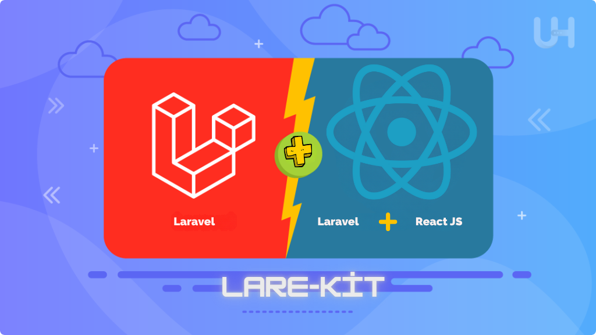

# Lare-Kit

<p align="center">
  <p align="center"><a href="https://laravel.com" target="_blank"></a></p> <p align="center"> <a href="https://github.com/laravel/framework/actions"></a> <a href="https://packagist.org/packages/laravel/framework"></a> <a href="https://packagist.org/packages/laravel/framework"></a> <a href="https://packagist.org/packages/laravel/framework"></a> </p>
</p>

<h3 align="center">
  Modern Laravel + React Full-Stack Starter Kit
</h3>

<p align="center">
  Build modern, scalable and production-ready web applications with Laravel, React, Vite and Tailwind CSS.
</p>

<p align="center">
  <a href="https://www.npmjs.com/package/lare-kit">
    
  </a>
  <a href="https://www.npmjs.com/package/lare-kit">
    
  </a>
  <a href="https://github.com/AlfaDeveloperr/lare-kit">
    
  </a>
  <a href="https://github.com/AlfaDeveloperr/lare-kit/blob/main/LICENSE">
    
  </a>
</p>

---

## 🚀 What is Lare-Kit?

**Lare-Kit** is a modern full-stack starter kit that combines the power of **Laravel** with the flexibility of **React**.

It provides a ready-to-use architecture for developers who want to build modern **Single Page Applications (SPA)** while using Laravel as a powerful backend and API layer.

Lare-Kit brings together:

* 🐘 Laravel
* ⚛️ React
* ⚡ Vite
* 🎨 Tailwind CSS
* 🧭 React Router
* 🗄️ Laravel Database Layer
* 🔐 API-based security architecture

The goal is simple:

> **Start building your application instead of spending hours configuring the same stack again and again.**

---

# ✨ Why Lare-Kit?

You can always install Laravel, React, Vite and Tailwind separately.

So why use Lare-Kit?

Because Lare-Kit is designed to give you a **consistent starting architecture** instead of an empty project.

### Without Lare-Kit

A typical project setup can require:

```text
Laravel
   ↓
Configure React
   ↓
Configure Vite
   ↓
Configure Tailwind
   ↓
Configure React Router
   ↓
Configure API communication
   ↓
Configure project structure
   ↓
Configure frontend architecture
   ↓
Start building
```

Every new project means repeating the same setup.

### With Lare-Kit

```text
Lare-Kit
   │
   ├── Laravel Backend
   ├── React Frontend
   ├── Vite
   ├── Tailwind CSS
   ├── React Router
   ├── API Architecture
   └── Scalable Project Structure
          ↓
      Start Building
```

Lare-Kit gives you the foundation so you can focus on the actual product.

---

# 🎨 Built for Modern UI & UX

Lare-Kit is not only about connecting Laravel and React.

The frontend architecture is designed specifically for building modern and maintainable **UI/UX experiences**.

With React and Tailwind CSS, you can create:

* Modern dashboards
* SaaS applications
* Admin panels
* Authentication interfaces
* Social applications
* E-commerce interfaces
* Business platforms
* Internal tools
* Custom web applications

The frontend can be completely customized without fighting against a rigid UI framework.

### UI Development

```text
React Components
       ↓
Reusable UI
       ↓
Tailwind CSS
       ↓
Responsive Design
       ↓
Modern User Experience
```

This makes it easier to build a consistent design system as your application grows.

---

# ⚡ How Lare-Kit Works

Lare-Kit separates the frontend and backend responsibilities while allowing them to work together as one application.

```text
┌──────────────────────────────┐
│          React SPA           │
│                              │
│  Pages • Components • UX     │
│  React Router • Tailwind     │
└──────────────┬───────────────┘
               │
               │ HTTP / API
               ▼
┌──────────────────────────────┐
│        Laravel Backend       │
│                              │
│ Routes • Controllers         │
│ Validation • Business Logic  │
│ Authentication • API         │
└──────────────┬───────────────┘
               │
               ▼
┌──────────────────────────────┐
│           Database           │
│                              │
│ MySQL / PostgreSQL / etc.    │
└──────────────────────────────┘
```

### 1. React handles the UI

React is responsible for:

* Rendering the interface
* Components
* Pages
* User interactions
* Client-side navigation
* UI state
* User experience

The main frontend entry point is:

```text
resources/js/main.jsx
```

---

### 2. React Router handles navigation

React Router manages frontend navigation.

For example:

```text
/dashboard
/profile
/settings
/products
```

The user can navigate between these pages without requiring a full browser reload.

This creates a smooth SPA experience.

---

### 3. Laravel provides the backend

Laravel handles:

* API endpoints
* Business logic
* Authentication
* Authorization
* Validation
* Database operations
* CRUD operations

API routes live inside:

```text
routes/api.php
```

---

### 4. API connects React and Laravel

React communicates with Laravel through HTTP requests.

Example:

```text
User
 │
 ▼
React UI
 │
 │ GET /api/products
 ▼
Laravel API
 │
 ▼
Controller
 │
 ▼
Model
 │
 ▼
Database
 │
 ▼
JSON Response
 │
 ▼
React UI
```

This separation keeps the frontend and backend clean and maintainable.

---

# 🏗️ Architecture

Lare-Kit follows a **Frontend + API Backend** architecture.

```text
                    LARE-KIT
                       │
          ┌────────────┴────────────┐
          │                         │
       FRONTEND                  BACKEND
          │                         │
       React                     Laravel
          │                         │
    React Router                REST API
          │                         │
    Tailwind CSS              Controllers
          │                         │
        Vite                     Models
                                    │
                                    ▼
                                Database
```

This architecture makes it easier to scale your application as the project grows.

---

# 🧩 Project Structure

```text
lare-kit/
│
├── app/
│   ├── Http/
│   │   └── Controllers/
│   ├── Models/
│   └── ...
│
├── database/
│   ├── migrations/
│   ├── seeders/
│   └── factories/
│
├── resources/
│   ├── css/
│   │   └── app.css
│   │
│   └── js/
│       ├── components/
│       ├── pages/
│       ├── layouts/
│       ├── hooks/
│       ├── App.jsx
│       └── main.jsx
│
├── routes/
│   ├── api.php
│   └── web.php
│
├── public/
│
├── package.json
├── composer.json
└── vite.config.js
```

---

# 🛠️ Technology Stack

| Technology   | Role                        |
| ------------ | --------------------------- |
| Laravel      | Backend & API               |
| React        | Frontend UI                 |
| Vite         | Development & build tooling |
| Tailwind CSS | UI styling                  |
| React Router | Client-side routing         |
| React Icons  | Icon library                |
| PHP          | Backend runtime             |
| Node.js      | Frontend runtime            |
| MySQL        | Database                    |

---

# 📦 Installation

## Requirements

Make sure you have installed:

* PHP >= 8.2.12
* Composer
* Node.js
* npm
* MySQL or another supported database

Check your environment:

```bash
php -v
composer -V
node -v
npm -v
```

---

## Clone the Repository

```bash
git clone https://github.com/AlfaDeveloperr/lare-kit.git

cd lare-kit
```

---

## Install Backend Dependencies

```bash
composer install
```

---

## Install Frontend Dependencies

```bash
npm install
```

---

## Configure Environment

```bash
cp .env.example .env
```

Generate the Laravel application key:

```bash
php artisan key:generate
```

Configure your database inside `.env`.

Example:

```env
DB_CONNECTION=mysql
DB_HOST=127.0.0.1
DB_PORT=3306
DB_DATABASE=lare_kit
DB_USERNAME=root
DB_PASSWORD=
```

---

## Run Database Migrations

```bash
php artisan migrate
```

---

# ▶️ Running the Application

Start the Laravel development server:

```bash
php artisan serve
```

Start Vite:

```bash
npm run dev
```

Open:

```text
http://127.0.0.1:8000
```

---

# 📦 NPM

Lare-Kit is also distributed through npm.

Install:

```bash
npm install lare-kit
```

NPM package:

https://www.npmjs.com/package/lare-kit

---

# 🔐 Security Architecture

Lare-Kit keeps backend security responsibilities inside Laravel.

The backend can handle:

* Authentication
* Authorization
* Request validation
* API protection
* Database security
* Business logic

Sensitive configuration should always remain inside environment variables.

Never commit:

```text
.env
```

or secrets/API keys to your repository.

For production applications, HTTPS and appropriate authentication mechanisms should always be configured.

---

# 🚀 Production

Build the frontend:

```bash
npm run build
```

For production environments, make sure to configure:

* `APP_ENV=production`
* `APP_DEBUG=false`
* Production database
* HTTPS
* CORS
* Cache configuration
* Queue workers when required
* Proper authentication

---

# 💡 What Can You Build With Lare-Kit?

Lare-Kit can be used as the foundation for many types of applications.

### SaaS

```text
Landing Page
      ↓
Authentication
      ↓
Dashboard
      ↓
Subscription
      ↓
Application
```

### Admin Panel

```text
Login
 ↓
Dashboard
 ↓
Users
 ↓
Products
 ↓
Reports
 ↓
Settings
```

### Social Application

```text
Authentication
      ↓
Feed
      ↓
Profiles
      ↓
Posts
      ↓
Comments
      ↓
Notifications
```

### Business Application

```text
Frontend
    ↓
Laravel API
    ↓
Business Logic
    ↓
Database
```

---

# 🗺️ Roadmap

Lare-Kit is actively evolving.

Planned improvements include:

* [ ] Authentication system
* [ ] Google OAuth
* [ ] Multi-factor authentication
* [ ] Improved API security
* [ ] Reusable UI component system
* [ ] CLI installer
* [ ] Automated project setup
* [ ] Testing infrastructure
* [ ] Better documentation
* [ ] Example applications
* [ ] Production deployment guides

---

# 🤝 Contributing

Contributions are welcome.

### 1. Fork the repository

### 2. Create a branch

```bash
git checkout -b feature/my-feature
```

### 3. Make your changes

### 4. Commit

```bash
git commit -m "feat: add my feature"
```

### 5. Push

```bash
git push origin feature/my-feature
```

### 6. Open a Pull Request

Please keep contributions focused, tested and consistent with the project's architecture.

---

# 📄 License

Lare-Kit is open-source software licensed under the **MIT License**.

See the `LICENSE` file for more information.

---

# ❤️ Credits

Lare-Kit is built on top of the amazing open-source ecosystem:

* Laravel
* React
* Vite
* Tailwind CSS
* React Router
* Node.js

Special thanks to the open-source community and everyone contributing to Lare-Kit.

---

<p align="center">
  <strong>Lare-Kit</strong>
  <br>
  Build faster. Scale better. Ship confidently. #vite,#react,#lare-kit,#SPA
</p>